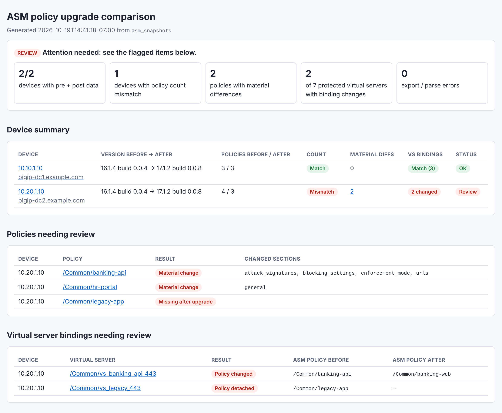
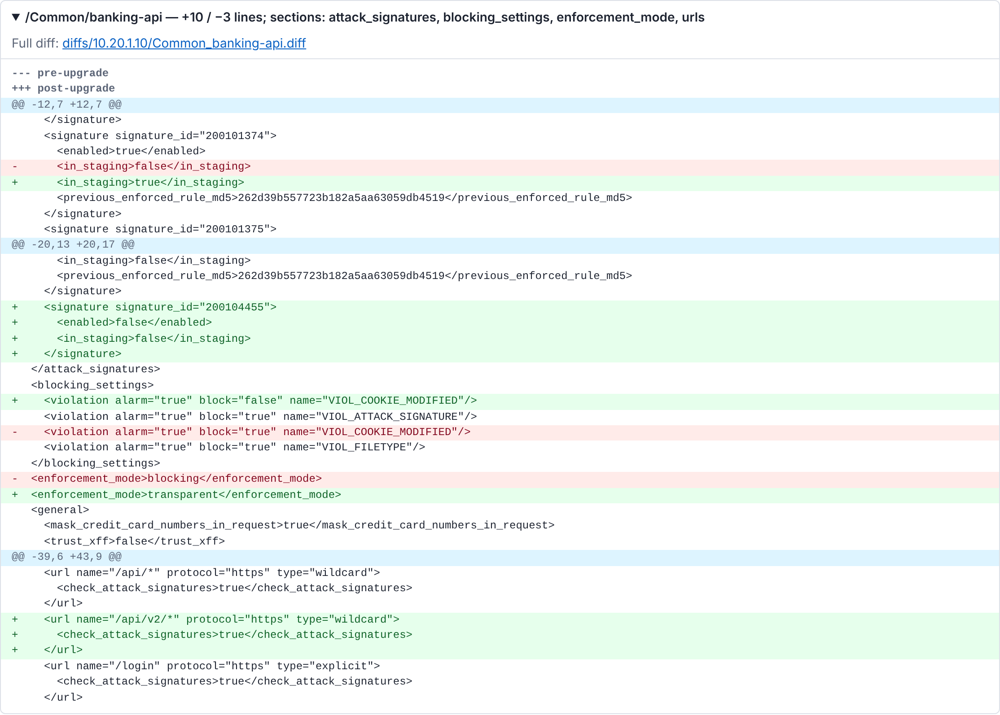
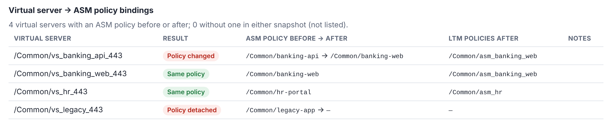

# asmPolicyDiff

Snapshot every ASM policy on one or more BIG-IPs before an upgrade, snapshot them again
afterwards, and get an HTML report that answers three questions:

1. **Does each device still have the same number of policies?**
2. **Did any policy change in a way that matters?** (export noise such as timestamps and
   version stamps is filtered out)
3. **Is every virtual server still protected by the same ASM policy?**

The report records the software version before and after for each device, and every
problem in the summary links to its details.

## Sample report

The sample below compares two fictional devices upgraded from 16.1.4 to 17.1.2.
`bigip-dc1` came through cleanly. `bigip-dc2` has two changed policies, one missing
policy, and two virtual servers whose ASM policy changed or was detached.



Each changed policy gets a diff of the normalized export, limited to what actually changed:



Each device also lists every protected virtual server and its ASM policy before and after:



The full sample is in [`docs/sample/`](docs/sample/). Download `report.html` and open it
in a browser; GitHub shows HTML files as source.

## Setup

```bash
python3 -m venv .venv && source .venv/bin/activate
pip install -r requirements.txt
```

Requires Python 3.8+ and network access to each BIG-IP's management interface (iControl REST).

## Usage

```bash
# 1. Before the upgrade
./asm_upgrade_diff.py export --phase pre  --host 10.1.1.245 -u admin

# 2. After the upgrade (builds the report automatically)
./asm_upgrade_diff.py export --phase post --host 10.1.1.245 -u admin --noise-file noise-filter.txt

# 3. Rebuild the report any time, for example after adjusting the noise filter
./asm_upgrade_diff.py report --noise-file noise-filter.txt
```

- **Several devices:** `--hosts-file devices.txt`, one IP or hostname per line
  (see `devices.example.txt`). Devices are exported in parallel (`--workers`, default 4).
- **Password:** `-p`, the `BIGIP_PASSWORD` environment variable, or an interactive prompt.
  Authentication uses an iControl REST token.
- **Protecting the baseline:** an existing snapshot is never overwritten unless you pass `--force`.
- **TLS:** certificates aren't verified by default; use `--verify` or `--ca-bundle FILE`.

The `report` command exits with `0` when everything matches and `2` when something needs
review, so it can gate an automated change.

## What counts as a "material" change

Before comparing, each XML export is normalized: attribute order is canonicalized,
whitespace trimmed and sibling elements sorted, so reordering isn't reported as a change.
Fields that change on every export (timestamps, `bigip_version`, `integrity_check` and
similar) are ignored by default.

Add your own rules with `--noise-file`. The rule syntax is documented at the top of
[`noise-filter.txt`](noise-filter.txt):

| Rule | Ignores |
|---|---|
| `timestamp` | an element with this name, anywhere |
| `urls/url` | an element at this path below the policy root |
| `@bigip_version` | an attribute with this name, on any element |
| `url@last_updated` | an attribute only on the named element |
| `re:<regex>` | any normalized line matching the regex |

For example, signature rules in staging are re-encrypted on every export, so the sample
report uses this rule. The rule's checksum, `previous_enforced_rule_md5`, is still compared:

```
previous_enforced_rule
```

The report footer lists every rule that was applied and where it came from.

## Output

Everything goes to `./asm_snapshots/` (git-ignored; change it with `-o`):

| Path | Contents |
|---|---|
| `<device>/pre/`, `<device>/post/` | exported policies and `manifest.json` (version, hostname, virtual server bindings, hashes) |
| `report.html` | the report |
| `report.json` | the same results, machine-readable |
| `diffs/<device>/<policy>.diff` | the full diff for each changed policy |

Exported policies contain your WAF configuration, so keep `asm_snapshots/` out of version control.
